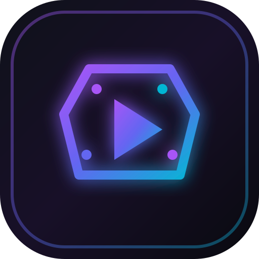

# ClipForge — Full-Featured Browser Video Editor

<p align="center">
  
</p>

<p align="center">
  <a href="https://github.com/Ghost0coder/ClipForge/releases"></a>
  <a href="LICENSE"></a>
  <a href="https://github.com/Ghost0coder/ClipForge/actions/workflows/ci.yml"></a>
  <a href="https://github.com/Ghost0coder/ClipForge/actions/workflows/deploy.yml"></a>
  
  
  
</p>

<p align="center">
  ClipForge is a CapCut-inspired, fully browser-based video editor built with React 19, Vite, Tailwind CSS 4, the Web Audio API, HTML5 Canvas, and Gemini AI — no server-side video processing required.
</p>

---

## ✨ Features

### 🎬 Multi-Track Timeline
- **Unlimited Tracks**: Video, Audio, Text, Sticker, and Effects tracks.
- **Editing Tools**: Split at playhead (`S`), Trim edge handles, Delete (`Del`), Ripple delete, Duplicate (`Ctrl+D`), Freeze frame, Reverse, Mute, Lock, Hide.
- **Snapping & Magnetic Timeline**: Snaps to playhead, markers, and clip boundaries.
- **Audio Waveforms**: Procedural and media waveform previews directly on audio tracks.
- **Keyframe Visualization**: Interactive keyframe markers for scale, position, rotation, and opacity.

### 🎨 Live Canvas Preview & Effects
- **60 FPS Live Rendering Engine**: Multi-track layered compositing with hardware acceleration.
- **30+ Color Filters**: Cinematic Teal & Orange, Film Noir, Retro 70s, Cyberpunk, Golden Hour, Bleach Bypass, Emerald, and more.
- **12+ Dynamic Visual Effects**: RGB split glitch, Camera shake, Zoom pulse, VHS scanlines, Film grain, Light leaks, TV static, Edge glow.
- **Transitions**: Fade, Cross Dissolve, Slide Left/Right, Zoom In/Out, Wipe Left, Glitch Cut.
- **Chroma Key**: Green screen removal with color picker, similarity, and smoothness controls.
- **Shape Masks**: Circle, Rectangle, Heart, Star with feathering.
- **Aspect Ratios**: 16:9 (YouTube), 9:16 (TikTok/Shorts), 1:1 (Square), 4:5 (Instagram), 21:9 (Cinematic Ultrawide).
- **Safe Area Guides**: TikTok / Shorts UI overlays and 3x3 Rule-of-Thirds grid.

### ✍️ Typography & Captions
- **50+ Google Fonts**: Bebas Neue, Outfit, Anton, Montserrat, Bungee, Righteous, Playfair Display, and more.
- **Text Styles**: Gradient fills, stroke outlines, drop shadows, background pill boxes.
- **Kinetic Animations**: Typewriter, Bounce, Neon Glow, Karaoke word highlighting.
- **Auto-Captions**: In-browser speech & transcript segmentation with SRT import/export.

### 🔊 Audio Studio & SFX
- **Web Audio API Engine**: Multi-track synchronized playback.
- **Built-in Music & SFX**: Hyper Pop, Lofi Chill, Cinematic, Whoosh, Sub Drop Impact, Bubble Pop, Camera Shutter, Success Ding, Laser.
- **Voiceover Recorder**: In-app microphone recording directly onto timeline tracks with live meter.
- **Beat Detection**: Auto-markers sync aligned to musical BPM.
- **Voice Changer**: Robot, Chipmunk, Deep voice, Radio, Echo presets.

### 🤖 Gemini AI Capabilities
- **AI Script-to-Video**: Generates scenes, visual descriptions, headlines, and filters from a text prompt.
- **AI Voiceover (TTS)**: Studio voice synthesis with voices `Kore`, `Puck`, `Charon`, `Fenrir`, `Zephyr`.
- **AI Graphic Overlays**: Custom sticker and graphic generator.
- **AI Smart Highlights**: Automatic scene detection and highlight clip extraction.

### 💾 Persistence & Export
- **IndexedDB**: Persistent local project library, autosave every 5 seconds, crash recovery.
- **Client-Side Export**: 480p, 720p, 1080p, 2K, 4K at 24/30/60 FPS (MP4 / WebM / GIF / MP3 / PNG Frame Snapshot).
- **PWA Support**: Install as a standalone app on desktop and mobile, with offline caching.

---

## 🚀 Setup & Running

### Prerequisites
- [Node.js](https://nodejs.org/) 18+ (or [Bun](https://bun.sh/))
- A [Google AI Studio](https://aistudio.google.com/) API key for Gemini features

### Installation

```bash
# Clone the repository
git clone https://github.com/Ghost0coder/ClipForge.git
cd ClipForge

# Install dependencies
npm install

# Copy environment variables and fill in your values
cp .env.example .env
```

### Environment Variables

| Variable | Required | Description |
|---|---|---|
| `GEMINI_API_KEY` | ✅ | Your Google AI Studio Gemini API key |
| `APP_URL` | Optional | The URL where the app is hosted (for OAuth callbacks) |

### Development

```bash
# Start development server (Express + Vite HMR proxy)
npm run dev
```

### Production

```bash
# Build for production
npm run build

# Start production server
npm start
```

---

## 🏗️ Tech Stack

| Layer | Technology |
|---|---|
| Frontend Framework | React 19 |
| Build Tool | Vite 8 |
| Styling | Tailwind CSS 4 |
| State Management | Zustand |
| Animation | Motion (Framer Motion) |
| Icons | Lucide React |
| AI | Google Gemini (`@google/genai`) |
| Backend | Express.js (API proxy) |
| Storage | IndexedDB (`idb`) |
| PWA | `vite-plugin-pwa` + Workbox |
| Analytics | Vercel Analytics |

---

## 🤝 Contributing

Contributions are welcome! Please follow these steps:

1. **Fork** the repository
2. **Create** a feature branch: `git checkout -b feat/your-feature-name`
3. **Commit** your changes using [Conventional Commits](https://www.conventionalcommits.org/): `git commit -m "feat: add amazing feature"`
4. **Push** to your branch: `git push origin feat/your-feature-name`
5. **Open** a Pull Request against `main`

Please ensure your PR:
- Passes the CI build (`npm run build`)
- Follows the existing code style
- Includes a clear description of what was changed and why

---

## 📋 Changelog

See [CHANGELOG.md](CHANGELOG.md) for a full history of changes.

---

## 📦 Releases & Packages

- **GitHub Releases**: [github.com/Ghost0coder/ClipForge/releases](https://github.com/Ghost0coder/ClipForge/releases)
- **GitHub Packages**: Published as `@ghost0coder/clipforge` on the [GitHub npm Registry](https://github.com/Ghost0coder/ClipForge/pkgs/npm/clipforge)

---

## 📄 License

ClipForge is open-source software licensed under the [MIT License](LICENSE).

---

<p align="center">Made with ❤️ by <a href="https://github.com/Ghost0coder">Ghost0coder</a></p>
